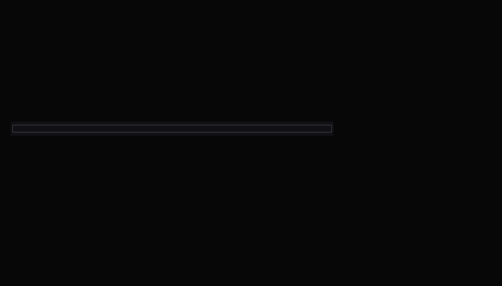
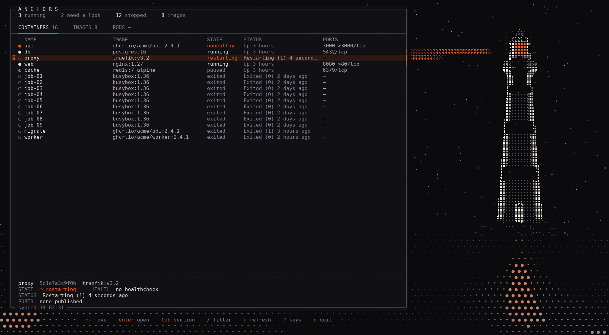
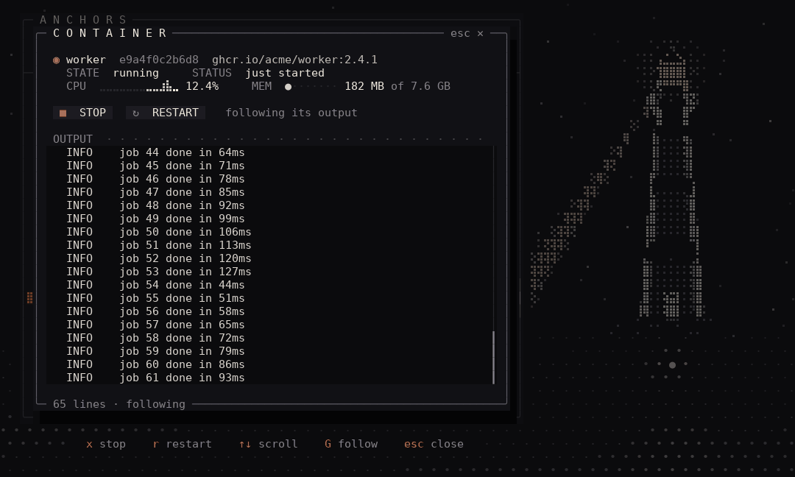
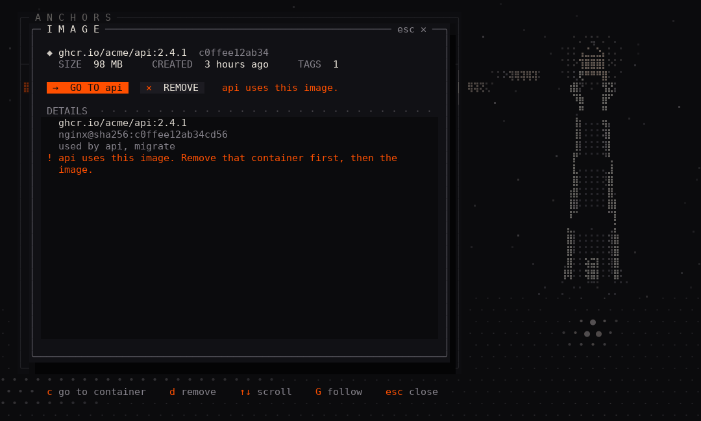
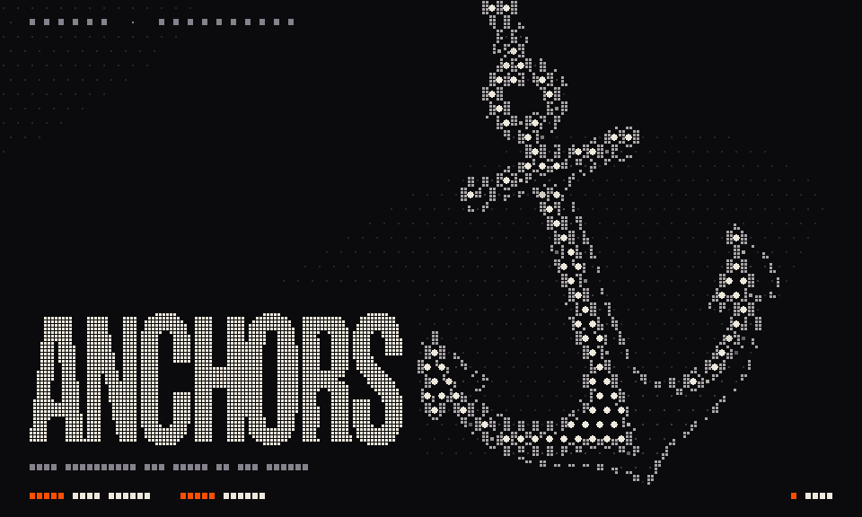

# anchors

**A terminal UI for Docker, drawn like a poster.**

anchors lists your containers and images and lets you act on them: start, stop, restart and remove them, follow their output, and watch their CPU and memory live. It does all of this from a single screen built to be looked at as much as used. The dashboard is a logbook beside a night sea. A lighthouse on the right swings its beam to whichever container you select, and the beam turns orange when that container needs a look.



> Kubernetes pods are next: the dashboard already has their section, waiting for a kubeconfig.

## What it does

**See everything at once**

- Every container (name, image, state, status, health, ports) and every local image (repository, tag, ID, size, age), refreshed every 5 seconds.
- A summary at the top: how many containers are running, how many need a look, how many are stopped, and how many images you have.
- States look the same everywhere:
  - a white `●` for running;
  - a grey `○` or `◐` for stopped or paused;
  - **orange** for anything unhealthy, restarting or dead.
- A container that changes state glows for a moment, so you notice.
- Filter any list with `/`.



**Act on a container** (click it, or press `enter`)

- **Start** a stopped container and follow what it prints in a small terminal inside the dialog. stderr lines are marked, and colour codes are cleaned up.
- **Stop** or **restart** a running one. While Docker waits for it to exit, you keep seeing its output.
- **Live CPU and memory**: a sparkline of recent CPU use and a memory bar, figured the way `docker stats` does.
- **Remove** a stopped container. It asks for a second press first, and the container's volumes are kept.
- If Docker refuses (a port already taken, say), the dialog shows why in orange and offers to retry. Nothing crashes.

**Clean up images** (open one from the IMAGES tab)

- **Remove** an image with all its tags, or **untag** just one name and keep the image.
- If a container still uses the image, anchors tells you which one before Docker refuses, and **GO TO** takes you straight to that container so you can stop and remove it.

<p align="center">
  
  
</p>

## Getting started

You need:

- **Go 1.27** or newer;
- a **Docker daemon** you can reach (anchors uses `DOCKER_HOST` if it's set, otherwise the local socket);
- a terminal with **truecolor**, a font with **Braille characters**, and mouse support (most modern terminals have all three);
- at least **80×24** cells; the lighthouse appears from 100 columns.

```bash
git clone https://github.com/BrunoArroyoC/anchors.git
cd anchors
go build -o anchors ./cmd/anchors
./anchors
```

Or run it without building: `go run ./cmd/anchors`.

If you get `permission denied` on the Docker socket, add yourself to the `docker` group (`sudo usermod -aG docker $USER`, then log in again). You can also point `DOCKER_HOST` at a daemon you can reach.

anchors opens on a title screen with a halftone anchor that reacts to your mouse. Press `enter` to go to the dashboard. Your containers and images load while the title is showing, so the dashboard opens with data.



## Keys

The footer always shows the keys that work right now. On the dashboard, `?` shows them all.

**Dashboard**

| Key | Does |
|---|---|
| `↑` `↓` / `j` `k` | move through the list (the mouse wheel works too) |
| `enter` / click | open the selected container or image |
| `tab` / `shift+tab`, `1` `2` `3` | switch between containers, images and pods |
| `pgup` `pgdn`, `g` `G` | page up and down, jump to the first or last row |
| `/` | filter; `enter` keeps the filter, `esc` clears it |
| `r` | refresh now (the beam sweeps the sea) |
| `?` | all the keys |
| `q` | quit |

**Container and image dialog**

| Key | Does |
|---|---|
| `enter` / `s` | start (or retry) |
| `x` | stop |
| `r` | restart |
| `d` | remove; press it again to confirm, `esc` to take it back |
| `u` | untag: remove only the image's first name |
| `c` | go to the container that uses this image |
| `↑` `↓`, `pgup` `pgdn` | scroll the output |
| `g` / `G` | jump to the oldest output / follow the newest again |
| `esc` / `q` | close the dialog |

Every button can also be clicked.

## Settings

| Variable | Effect |
|---|---|
| `DOCKER_HOST` | which Docker daemon to talk to, e.g. `unix:///run/user/1000/docker.sock` or `tcp://host:2375` |
| `ANCHORS_REDUCE_MOTION=1` | a calm version of every screen: no swell, ripples or flashes, rows appear without printing in |

## Roadmap

- [x] Dashboard: containers and images, live refresh, filter
- [x] Start, stop, restart and remove containers
- [x] Follow a container's output
- [x] Live CPU and memory
- [x] Remove images and tags, and find the container that blocks a removal
- [ ] Kubernetes pods (through your kubeconfig)
- [ ] `exec` into a container
- [ ] Pull images, prune unused ones

## How it's built

anchors is written in Go with [Bubble Tea](https://github.com/charmbracelet/bubbletea), [Bubbles](https://github.com/charmbracelet/bubbles) and [Lip Gloss](https://github.com/charmbracelet/lipgloss), and talks to Docker through the official [moby client](https://github.com/moby/moby/tree/master/client). The code has four layers, and each one only calls the layers below it:

```
internal/screen     the UI: Bubble Tea models, the halftone canvas, the theme
internal/bridge     turns each Docker call into a Bubble Tea command and message
internal/functions  talks to Docker: plain Go, no UI
internal/models     the data every layer shares
```

The art is a halftone of round glyphs and Braille dots drawn on a custom canvas that writes truecolor ANSI directly, fast enough for 30 frames per second. Animation runs only while something moves; at rest the app stops redrawing and uses no CPU.

```bash
go test ./...                                                    # all tests
ANCHORS_SNAPSHOT_DIR=/tmp/frames go test ./internal/screen/...   # also write every test frame to disk
```

The screenshots above are frames from those tests, using their sample containers and images.

## License

[MIT](LICENSE) © 2026 BrunoArroyoC
